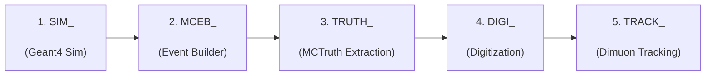

# HTCondor DAGMan Workflow: SND@LHC Full Simulation Pipeline

Automated Directed Acyclic Graph Manager (DAGMan) orchestration for the complete SND@LHC neutrino simulation, event building, truth extraction, digitization, and dimuon track reconstruction pipeline.

---

## Workflow Architecture per Partition

Each partition executes as an independent sub-pipeline:



### Key Advantages
- **No Global Bottleneck**: Partitions that finish early immediately advance to downstream stages without waiting for slower partitions.
- **Automatic Retry**: Failed jobs automatically retry up to 2 times (`RETRY Node 2`) to absorb transient network or FUSE hiccups.
- **Automatic Rescue DAGs**: If any partition fails permanently, re-submitting `condor_submit_dag pipeline.dag` automatically picks up `pipeline.dag.rescue001` and only executes incomplete/failed nodes.
- **Schedd & EOS Throttling**: `dagman.config` limits total concurrently running jobs to 300 to protect EOS bandwidth and avoid lxplus quota limits.

---

## Directory Structure

```text
htcondor/dagman/
├── dagman.config            # Concurrency & log scanning configuration
├── generate_dag.py          # Python script to generate pipeline.dag
├── submit_dag.sh            # Wrapper to generate & submit DAG to HTCondor
├── status_dag.sh            # Progress monitor across all 5 stages on EOS
├── sub/                     # Single-job submit descriptions
│   ├── simulate.sub         # Stage 1
│   ├── mceb.sub             # Stage 2
│   ├── mctruth.sub          # Stage 3
│   ├── digi.sub             # Stage 4
│   └── dimuon_tracking.sub  # Stage 5
├── out/                     # Stdout logs per node
├── err/                     # Stderr logs per node
└── log/                     # HTCondor shared job log
```

---

## Quick Start (from lxplus)

### 1. Test Small Partition Range (Dry-Run)
```bash
./submit_dag.sh -p 1-5 --dry-run
```

### 2. Submit Test Subset (e.g. Partitions 1 to 10)
```bash
./submit_dag.sh -p 1-10
```

### 3. Submit Full 1,000 Partitions
```bash
./submit_dag.sh -p 1-1000
```

### 4. Run Only Specific Stages
```bash
# E.g. Run only digitization and tracking for partitions 1 to 50:
./submit_dag.sh -p 1-50 -s digi,track
```

---

## Monitoring & Management

### Monitor Progress
```bash
# Check stage completion counters across EOS:
./status_dag.sh

# Check active HTCondor queue tree:
condor_q -dag
```

### Pause / Resume Workflow
```bash
condor_hold <DAGMan_ClusterId>
condor_release <DAGMan_ClusterId>
```

### Stop / Cancel Workflow
```bash
condor_rm <DAGMan_ClusterId>
```

### Re-running Failed Jobs (Rescue DAG)
If any jobs fail after retries are exhausted, DAGMan generates a rescue DAG (`pipeline.dag.rescue001`). Simply re-run:
```bash
condor_submit_dag pipeline.dag
```
It will automatically resume from the exact point of failure without repeating completed stages.
